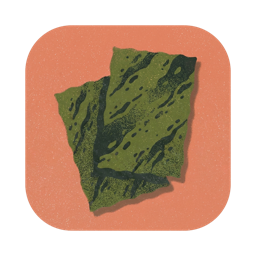
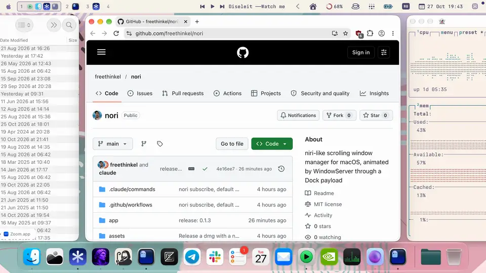

<h1 align="center"> nori</h1>

nori is a scrolling window manager for macOS, modeled on [niri](https://github.com/YaLTeR/niri). Windows stand side by side as columns on a horizontal strip, and the focused one sits in the middle of the screen.



It's a prototype. WindowServer moves the windows, not Accessibility. A dylib loaded into Dock calls private SkyLight functions every frame, so animations run on vsync and a slow app can't make them stutter. The price is that part of System Integrity Protection has to be off.

## Features

- Every window of the current Space is a column. The focused window sits in the center, the others line up left and right, `gap` apart. With `center-focused-column` the strip scrolls only as far as it takes to show the focused window whole, as in niri and OmniWM.
- A new window opens right of the focused one and the strip scrolls to it. When a window closes, its neighbours close the gap.
- Clicking a window or switching to it with Cmd+Tab scrolls the strip to it.
- nori stretches a window to the full screen height when it joins the strip, and keeps it there: resized by hand, it goes back. A window that won't take that height (fixed size, min/max limits) keeps the height it took.
- Three fingers sideways drag the strip. Lift, and it settles on the nearest column. Past either end it stretches like rubber.
- Three fingers up or down move through Spaces the same way. The Spaces follow your fingers, and on lift the nearest one slides to the center, or the next one if you flicked. nori swallows the three- and four-finger gesture events it can, and turns Mission Control and App Exposé off while it runs, putting them back when it quits, see [macOS settings](#3-macos-settings).
- Drop a window you dragged with the mouse and it eases back into its column.
- Every Space has its own strip. A fullscreen app's Space has none: nori leaves its window as macOS made it.
- Fullscreen Spaces sit in the vertical stack where Mission Control has them, so Opt+J/K, the swipes and the overview reach them. nori switches to one with Dock's "Move left/right a space" shortcut, see [macOS settings](#3-macos-settings).
- Spaces switch vertically, on the same curve as windows. nori catches every "Switch to Desktop N" press, from the keyboard, from Opt+J/K or from `nori focus space`. Dock still switches the Space and the payload draws the slide. If nori quits or crashes, Dock goes back to its usual horizontal animation, and an open overview closes by itself.
- An overview like niri's shows all Spaces of the display stacked and scaled down, with live windows. Four fingers drive it. It follows the swipe, stretches past fully open or closed, and on lift springs open or shut depending on how fast you threw it.

## Setup

nori runs on Apple Silicon, and it is tested on macOS 27 only. The app says it needs macOS 14 or newer, but nothing older than 27 has been tried. On another macOS build parts of it may not go into Dock: nori then keeps running without them and tells you which, see [When something is wrong](#when-something-is-wrong). Dock only loads a third-party dylib with part of SIP off, and that weakens the security of the whole machine. Do it on your own Mac, and see [Undo](#undo) for the way back. The steps match [yabai's](https://github.com/koekeishiya/yabai/wiki/Disabling-System-Integrity-Protection).

### 1. Turn off part of SIP, once, from Recovery

The app can't do this step for you. If SIP is still on, the app shows these steps and copies the command for you.

1. Shut the Mac down. Hold the power button until "Loading startup options" appears, then click Options → Continue and log in.
2. In the menu bar choose Utilities → Terminal and run
   ```sh
   csrutil enable --without fs --without debug --without nvram
   ```
   It warns about an unsupported configuration. That's expected.
3. Restart.

This turns off three protections. Without Debugging Restrictions the loader may call `task_for_pid` on Dock. Without NVRAM Protections the app can set the boot argument below. Without Filesystem Protections the app can grant itself Accessibility. The rest of SIP stays on.

### 2. Build and open the app

```sh
make app
open build/Nori.app     # or copy it to /Applications first
```

On launch the app checks the rest and fixes what it can. It asks for your password when it needs root.

1. **Boot argument.** Dock is an arm64e process and loads a third-party arm64e dylib only with `-arm64e_preview_abi` in `boot-args`. If the argument is missing, the app adds it and asks you to restart the Mac.
2. **Accessibility.** The event tap and window resizing need it. The app asks for your password and adds itself to the system's permission database. An app you built yourself has an ad hoc signature, so it does this again after each rebuild, and the new entry replaces the old one. If you cancel, or Filesystem Protections are on, macOS shows its own prompt: allow nori in System Settings → Privacy & Security → Accessibility and the app carries on by itself.
3. **Payload.** If Dock doesn't have it, which happens on first launch and after a reboot or a Dock restart, the app restarts Dock and loads it.

After that nori lives in the menu bar.

| Menu item | What it does |
|---|---|
| Check for Updates… | asks GitHub for a newer release, which nori also does at launch and each time the menu opens; becomes "Update to vX" once one is found. An app you built yourself opens the release page instead of updating |
| Settings…, ⌘, | a window with every setting, key binding and app rule. Its toolbar menu opens `~/.config/nori/config.toml` in your text editor and reloads it. See [Config](#config) |
| Restart Dock and Reload Payload | use it after a rebuild, so Dock runs the new payload. The line under it says whether the payload is running in Dock. If you cancel the password, nori keeps running |
| Quit nori, ⌘Q | puts Spaces and windows back and quits. The payload stays in Dock and does nothing |

#### When something is wrong

A `!` beside the menu bar item means nori has a problem. The menu then lists each one at the top, with what you lose and what to do; choosing one fixes it where nori can. A problem leaves the list once it is fixed. "Copy Problem Report" puts the list, nori's version and the macOS build on the clipboard for a bug report, and `nori problems` prints the same.

If Dock restarts (a crash, `killall Dock`), nori's payload goes with it, windows and Spaces stop moving, and the overview can't open. nori asks once whether to reload. Reloading restarts Dock again and may ask for your password; choose Later and the menu keeps the offer.

The payload patches four SkyLight functions in Dock, and first checks their code byte for byte, as it can change between macOS builds. One that doesn't match stays unpatched, and nori lists it with what you lose. The strip and the overview keep working. Without `SLSTransactionSetSpaceTransform` Space switches mix in Dock's horizontal slide and windows on every Space, like a status bar, move with the Spaces; the others cost a black band in Space switches, or a jump or a blink in the overview. Choosing the item copies the report, with the macOS build, for an issue. If macOS lacks a function the payload calls, it doesn't load at all, and nori says so at launch and quits.

### 3. macOS settings

At launch nori checks the Desktop shortcuts below for the Desktops you have, and if some are off it offers to turn them on, keeping the keys they have. Say Not Now and it won't ask again: a switch that needs one beeps and stays where it is, and nori's menu keeps the offer.

- **Desktop shortcuts.** Turn on "Switch to Desktop 1…N" in System Settings → Keyboard → Keyboard Shortcuts → Mission Control. Opt+J/K, the overview and `nori focus space` press them to switch Spaces. A fullscreen app's Space has no such shortcut: to reach one nori presses "Move left a space" / "Move right a space" from the same list, so turn those on too (any keys, they don't have to stay Ctrl+←/→). Without them nori brings the app to the front, which finds its fullscreen Space only if that is the app's front window.
- **Trackpad.** In System Settings → Trackpad → More Gestures, set "Swipe between full-screen applications" to four fingers or turn it off. Otherwise macOS flips Spaces along with the strip. **Mission Control** and **App Exposé** use the same 3- and 4-finger swipes, and macOS can act on them before nori's event tap sees the gesture. Unless `leave-system-gestures = true`, nori turns both off while it runs (`showMissionControlGestureEnabled` and `showAppExposeGestureEnabled` in `com.apple.dock`) and restores them when it quits, restarting Dock to apply each change, so the next launch loads the payload again (password); Mission Control stays on its keyboard shortcut. If nori crashes they stay off until the next launch or quit.
- **yabai.** If you have it, stop it while nori runs with `yabai --stop-service`, or at least run `yabai -m config layout float`.

### Check by hand

```sh
csrutil status     # "unknown (Custom Configuration)", Filesystem Protections,
                   # Debugging Restrictions and NVRAM Protections disabled
nvram boot-args    # boot-args	-arm64e_preview_abi
/usr/bin/log show --last 5m --predicate 'process == "Dock" AND eventMessage CONTAINS "nori"' --style compact   # payload log
```

### Running from a terminal

For development, run the binary without the bundle. It shows the same menu bar item and runs the same checks.

```sh
make        # builds everything into build/
make run    # stops a running nori, restarts Dock, loads the payload with sudo, runs nori in this terminal
```

Ctrl+C stops it. If you only changed the daemon, Dock needs no restart. Press Ctrl+C and run `build/nori` again.

`NORI_CONFIG=/path/to/config.toml build/nori` reads and writes that file instead of `~/.config/nori/config.toml`, to try settings out without touching yours.

### Releases

CI (`.github/workflows/build.yml`) builds an ad-hoc signed app on every push. When a push to main carries a version in `app/Info.plist` (`make version`) that has no release yet, CI signs the app with Developer ID, notarizes it, tags `v<version>` and attaches `Nori.dmg` to a GitHub release. People install from it, and the app's updater downloads it. `make dmg` builds the dmg locally (needs pipx); its background is `assets/dmg-background.png`, the layout `assets/dmg.py`. So a release is a version bump: `/make-new-release [patch|minor|major|X.Y.Z]` in Claude Code does it. CI needs these repository secrets:

| Secret | Value |
|---|---|
| `MACOS_CERTIFICATE` | the Developer ID Application certificate with its private key, exported as .p12 and base64-encoded |
| `MACOS_CERTIFICATE_PASSWORD` | the .p12 password |
| `NOTARY_KEY` | contents of an App Store Connect API key (.p8) with the Developer role |
| `NOTARY_KEY_ID`, `NOTARY_ISSUER_ID` | that key's ID and its issuer ID |

Locally: `make app SIGN="Developer ID Application"`.

A released app checks GitHub for a newer release at launch and every 6 hours, and offers it at the top of its menu. The update replaces the app, relaunches it and reloads the payload into Dock (password). An ad hoc build from `make app` never updates.

### Undo

1. In a normal Terminal, while NVRAM Protections are still off, run `sudo nvram -d boot-args`.
2. Boot into Recovery as in step 1, run `csrutil enable` and restart.

A repair at Apple or an authorized service provider may turn SIP back on too. Then repeat step 1.

## Keys

Every row with a config name can be rebound in `[bindings]`, or unbound with `"none"`.

| Keys | Action |
|---|---|
| Opt+H / Opt+L | column to the left / right. Config names `focus-left`, `focus-right` |
| Ctrl+Opt+H / Ctrl+Opt+L | first / last column. Config names `focus-first`, `focus-last` |
| Opt+J / Opt+K | Space below / above, through the system "Switch to Desktop N" shortcuts. In the overview the neighbour slides to the center and becomes current, and the overview stays open. Config names `focus-space-down`, `focus-space-up` |
| Opt+C | scroll the focused window to the center, whatever `center-focused-column` says. Config name `center-column` |
| Opt+= / Opt+- | focused window wider / narrower by `resize-step`, animated. Config names `grow-width`, `shrink-width` |
| Opt+. / Opt+, | focused window to the next wider / narrower of 1/3, 1/2 and 2/3 of the screen, round at either end. Config names `cycle-width-forward`, `cycle-width-backward` |
| Opt+Shift+F | focused window to the full width, and back to its width before. Config name `toggle-full-width` |
| Opt+Shift+H / Opt+Shift+L | move the focused window one column left / right. Config names `move-left`, `move-right` |
| Opt+Shift+1…9 | send the focused window to Desktop N. Focus stays on this Space. Config names `move-to-space-N` |
| Opt+Shift+J / Opt+Shift+K | send the focused window to the Space below / above. Config names `move-to-space-down`, `move-to-space-up` |
| Opt + left drag (`mouse-modifier`) | move the window under the pointer. It trades places with a neighbour once it passes the neighbour's center |
| Opt + right drag (`mouse-modifier`) | resize the window under the pointer. It takes focus, and both edges follow the pointer, or only the right one when `center-focused-column` doesn't center it |
| Opt+1…5 | Space 1…5. These are the system "Switch to Desktop N" shortcuts, and nori animates the switch itself |
| Opt+O | overview. Click a Space to pick it and the window under the pointer. Drag a window onto another Space to move it there. Esc or Opt+O closes it. Config name `overview` |
| Opt+F | every window of this Space outside the strip (floating rules, dialogs, panels, PiP) comes above the strip's. Focus stays where it was. Config name `show-floating` |
| Opt+Shift+V | the focused window leaves the strip and floats in the middle of the screen at 2/3 of its width and height; again on that window puts it back right of the focused column, at its old width. nori remembers it across restarts. Config name `toggle-floating` |
| in the overview: H/L or ←/→, J/K or ↓/↑, Return | move through the centered Space's columns, bring the Space below or above to the center, pick it |
| 4 fingers up / down | the overview follows the swipe and settles open or closed on lift. This replaces Mission Control on four fingers, with Mission Control's gesture turned off while nori runs |

## Config

To have an assistant write it for you, give it [llms.txt](llms.txt) (raw: `https://raw.githubusercontent.com/freethinkel/nori/main/llms.txt`) and say what you want.

Or choose Settings… (⌘,) in the menu. The window edits the same file, and each change applies at once, like "Reload Config". It changes a value in its own line and adds a missing key under the last key of its table, so your comments, rules and their order stay as you wrote them. After an edit by hand, `nori reload` or "Reload Config" in the window's toolbar menu shows it there too. Hotkeys records a binding when you click it and press the keys: Esc cancels, Delete unbinds, and a binding needs Control, Option or Command. Two actions on the same keys, or an action on a "Switch to Desktop N" shortcut (that one wins), show in red. App Rules lists the `[[rule]]` tables in file order; + adds one for a running app, and the window button by a rule's Title fills it in from one of that app's open windows.

nori reads `~/.config/nori/config.toml`, a [TOML](https://toml.io) file, at start and on "Reload Config". If the file doesn't exist, nori writes it first with every setting, its default and a comment on what it does; optional ones are commented out. The same text is always in `config.default.toml` next to it, rewritten on every start. If it meets a key it doesn't know, a value of the wrong kind or a rule it can't use, it skips that and applies the rest, and lists what it skipped at the top of Settings → General, with a `!` on the menu bar item, after every launch and reload. Run from a terminal, it prints them to stderr too.

```toml
gap = 16                  # between windows, in points
padding-top = 40          # from the menu bar
padding-bottom = 0        # from the Dock or the bottom of the screen
padding-left = 24
padding-right = 24
resize-step = 10          # width step, % of screen width, default 10
launch-at-login = true    # start Nori.app at login, default false
analytics = true          # one anonymous `active` event a day, see Analytics, default true
overview-background = "blur"  # behind the overview's Spaces: "none" (black, default) or "blur"
overview-scale = 0.4      # size of the Spaces in the overview, 0.2 to 0.8, default 0.4
gesture-strip = "3 sideways"     # the swipe that moves the strip, default "3 sideways"
gesture-spaces = "3 vertical"    # the swipe that switches Spaces, default "3 vertical"
gesture-overview = "4 vertical"  # the swipe that opens the overview, default "4 vertical"
swipe-speed = 1.3         # strip points per point of finger travel, 0.25 to 5, default 1.3
space-swipe-distance = 50 # swipe per Space, % of the trackpad, 10 to 100, default 50
overview-swipe-distance = 30   # swipe from closed to open, % of the trackpad, 10 to 100, default 30
leave-system-gestures = false  # keep Mission Control and App Exposé, from the next launch, default false
center-focused-column = "always"     # "always" (default), "never" or "on-overflow"
always-center-single-column = false  # a lone window in the center whatever the above says, default false
wrap-around = false       # focus past the last column or Space goes round to the first, default false
inactive-opacity = 1.0    # unfocused windows of the strip at this opacity, 0.1 to 1, default 1 (off)
mouse-modifier = "option" # held for a drag that moves (left button) or resizes (right button) a window

[bindings]
focus-left = "option+h"
focus-right = "option+l"
focus-first = "ctrl+option+h"
focus-last = "ctrl+option+l"
focus-space-down = "option+j"
focus-space-up = "option+k"
center-column = "option+c"
overview = "option+o"
show-floating = "option+f"
toggle-floating = "option+shift+v"
grow-width = "option+="
shrink-width = "option+-"
cycle-width-forward = "option+."
cycle-width-backward = "option+,"
toggle-full-width = "option+shift+f"
move-left = "option+shift+h"
move-right = "option+shift+l"
move-to-space-down = "option+shift+j"
move-to-space-up = "option+shift+k"
move-to-space-1 = "option+shift+1"   # … up to move-to-space-9

[[rule]]
app = "Telegram"
space = 3
```

Missing numbers are 0, unless a default is shown above. A missing binding keeps the default shown above; `"none"` unbinds the action. A binding is modifiers and one key joined by `+`. Modifiers are `option` or `alt`, `ctrl`, `cmd` and `shift`. The key is a letter, a digit, `-`, `=`, `,`, `.`, `left`, `right`, `up` or `down`, and nori reads it as a physical key on the US layout, so the binding stays put when you switch layouts.

`overview-background = "blur"` puts the current wallpaper of the main display, blurred and dimmed by 30%, around and between the Spaces in the overview. It is read when the overview opens, so a wallpaper change shows up on the next open. `overview-scale` takes effect on the next open too. The payload learns it from the daemon, so after updating from a version without this setting it needs a reload (Restart Dock and Reload Payload in the menu).

A gesture is 3, 4 or 5 fingers and a way, or `"none"`. Each action takes only the way it moves: `sideways` for the strip, `vertical` for Spaces, `vertical` or `pinch` for the overview, where closing the fingers in opens it and spreading them closes it. A swipe belongs to one action: in Settings, picking one in use moves the other action to the fingers this one left, and in the file the first of strip, Spaces, overview wins. macOS gets the swipes of a finger count no action is on. `leave-system-gestures = true` keeps Mission Control and App Exposé on from the next launch. macOS may then act on nori's swipes too, so turn off nori's gestures on the finger count they use.

`center-focused-column` decides where the focused window sits, like niri's and OmniWM's setting of that name. `"always"` puts it in the center. `"never"` scrolls the strip only as far as it takes to show it whole, against the left or right padding, so a window already on screen doesn't move the strip and a lone window sits at the left. `"on-overflow"` centers it when it doesn't fit on screen beside the window focus came from, and otherwise acts like `"never"`. Three fingers settle the strip the same way: on a centered window, or with one against the padding. `always-center-single-column = true` centers a lone window in any mode.

The width presets count the gap in, so two windows at 1/2, or one at 1/3 and one at 2/3, fill the space between the paddings exactly. An app with a minimum or maximum width gets as close as it allows.

`wrap-around` applies to `focus-left`, `focus-right`, `focus-space-up`, `focus-space-down`, `move-to-space-up` and `move-to-space-down`. `inactive-opacity` sets the alpha of the strip's unfocused windows in WindowServer, so the focused one stands out; floating windows and other apps' alpha are left alone. `mouse-modifier` is one or more modifiers joined by `+`, like `"ctrl+option"`.

`launch-at-login` adds Nori.app to System Settings → General → Login Items, or removes it, at launch and on "Reload Config". It only works for the app, not for `build/nori` in a terminal. The login item remembers where the bundle is, so move the app to /Applications first.

The TOML reader is nori's own and only knows what this file needs. That's comments, plain keys, `"strings"`, `'literal strings'`, numbers, `true`, `false`, `[tables]` and `[[arrays of tables]]`. It skips lines with dotted or quoted keys, arrays, inline tables, multi-line strings or dates, and lists them the same way.

### App rules

Only standard windows join the strip. Dialogs, floating panels, sheets and browser popups (permission prompts, save bubbles, file pickers) stay where their app puts them, with no rule needed.

Each app gets one `[[rule]]` table, or several with a `title`. `app` is the app's name or bundle id, in any case; `title` is a regular expression the window's title must contain, case-insensitive. The first rule that matches a window wins, and one rule can do several things.

```toml
[[rule]]
app = "Telegram"
space = 3              # new Telegram windows go to Desktop 3

[[rule]]
app = "com.apple.finder"
floating = true        # Finder windows stay out of the strip, wherever you put them

[[rule]]
app = "Raycast"
ignore = true          # nori doesn't move or list Raycast's windows

[[rule]]
app = "Ghostty"
width = 50             # a new Ghostty window takes half the width, in % of the usable width

[[rule]]
app = "Safari"
title = "Picture in Picture"
floating = true        # only Safari's PiP window floats; its other windows stay columns
```

- `space = N` moves a window once, the first time nori sees it. That includes windows already open when nori starts. Move it back by hand and it stays. Focus stays on the current Space, unless the strip there is empty.
- `floating = true` keeps the app's windows out of the strip. nori doesn't move or resize them, and `nori query windows` lists them with `"isFloating": true`.
- `ignore = true` hides the app from nori completely, `nori query` too. Raycast, Alfred, Spotlight and LaunchBar are ignored without a rule; a `[[rule]]` of your own for one of them comes first and wins.
- `width = N` sizes a window once, when it joins the strip, to N % of the usable width. The gap is counted in like the presets, so two windows at 50 fill the screen exactly. Resize it afterwards and it stays.
- `title` needs the title: on the current Space nori reads it through Accessibility, on other Spaces only with Screen Recording permission. Without a title the rule doesn't match and the next one is tried, so put a plain `app` rule after it as the fallback.
- "Reload Config" applies changed `floating` and `ignore` rules to open windows at once. A new `space` or `width` rule only affects windows nori hasn't seen yet.

## CLI

`nori` with arguments is the CLI. It asks the running nori about Spaces and windows, or tells it what to do: every key binding has a command here, so a bar, Raycast or Hammerspoon can drive nori with the bindings set to `"none"`. Queries answer in JSON, so `jq` works well with it. Actions print nothing when they work. On an error, or if nori isn't running, it prints to stderr and exits with 1.

Link the binary from the app somewhere on your PATH.

```sh
ln -s /Applications/Nori.app/Contents/MacOS/nori /opt/homebrew/bin/nori
```

```sh
nori query spaces [--current]           # number, windows, apps with their windows, column order
nori query windows [--space N] [--current] [--app NAME] [--id WID] [--focused]
nori focus left|right|first|last        # a column of the current Space
nori focus column N                     # column N on the current Space, counting from 1
nori focus space N|up|down              # Desktop N or the neighbour, through "Switch to Desktop N"
nori focus window WID                   # a window by id, switching Spaces if needed
                                        # any focus takes --instant: no slide, no ease
nori move left|right                    # the focused window one column over
nori move space N|up|down               # the focused window to Desktop N or the neighbour
nori width grow|shrink                  # by resize-step
nori width next|previous                # the next of 1/3, 1/2, 2/3
nori width toggle-full                  # full width, and back
nori center                             # scroll the focused window to the center
nori overview                           # open or close the overview
nori show floating                      # windows outside the strip above it
nori toggle floating                    # the focused window out of the strip and back
nori reload                             # read the config again, like "Reload Config"
nori problems                           # what is wrong right now, with the nori and macOS versions
nori subscribe                          # one line of `query spaces` JSON now and on every change
nori help

nori query windows --space 2 | jq -r '.[].app'
nori focus window "$(nori query windows --app Telegram | jq '.[0].id')"
nori subscribe | jq -c --unbuffered '.[] | select(.isFocused) | .number'
```

A Space has `id`, `number`, `display`, `type`, `isFocused`, `isVisible`, `isAnimating`, `windows`, `columns`, `focusedWindow` and `apps`. `isFocused` marks the one Space that has focus. It moves as soon as nori starts a switch (a Desktop shortcut, Opt+J/K, a swipe, the overview, `nori focus space`), before the slide ends. `isVisible` marks the Space each display shows. `isAnimating` is true while a nori animation moves or scales the Space (a switch, the overview); meanwhile the frames macOS reports for its windows (`CGWindowListCopyWindowInfo`) have that motion in them, so a bar that judges windows by their frames should wait for it to turn false. `columns` is the strip left to right. On a Space nori hasn't shown yet it is the order the strip will get there. `focusedWindow` is the focused window on the focused Space, from Accessibility, and on other Spaces the window that had focus there last.

`nori subscribe` writes the whole `query spaces` array as one compact line, at once and then on every change: a Space switch, a window opening, closing or moving to another Space, focus, a column moving. A line only goes out when it differs from the last one. When nori quits, `subscribe` exits with 2.

A bar can skip the CLI and talk to the socket `/tmp/nori-ctl_$USER.socket` itself. A request is the CLI's arguments joined by tabs, one line, like `query\tspaces\n` or `subscribe\n`. nori answers and closes the connection, except after `subscribe`. The socket path and this format are public: they change only with a note in the release.

A window has `id`, `pid`, `app`, `bundleId`, `title`, `space`, `spaceId`, `spaceType`, `column`, `isFocused`, `isOnScreen`, `isFloating` and `frame`. `space` is the Desktop number, missing for a window in a fullscreen app's Space. `spaceType` is that Space's `type`, `desktop` or `fullscreen`. `column` counts from 1 and is missing for windows outside the strip. `--app` matches the app name or bundle id in any case. Desktops count from 1 across all displays, like the system shortcuts. Fullscreen Spaces have no number, and their `type` is `fullscreen`.

nori sees the titles of windows on other Spaces only with Screen Recording permission. When you run it from a terminal, the terminal needs that permission. Titles on the current Space come from Accessibility.

`nori` without arguments starts nori itself. A second copy refuses to start while one is running.

## Limitations

- One window per column.
- nori learns about new windows and focus changes from Accessibility and NSWorkspace notifications. If a window closes and focus doesn't move, nori notices on its next poll, up to a second later.
- Main display only.
- On quit, windows go back to where they were before nori. Windows of the current Space get their size back too; Accessibility doesn't reach other Spaces, so windows there keep the size nori gave them. After a crash windows stay where nori put them until the next nori quits: it remembers their frames in `~/Library/Application Support/nori/strips.json`.

## Analytics

To know how many people run it, nori sends one anonymous `active` event a day to a self-hosted [Aptabase](https://aptabase.com): the nori and macOS versions, nothing about your windows, apps or keys. Aptabase keeps the country, not the IP address. To turn it off, switch off Share anonymous usage in Settings → About, which is `analytics = false` in the config. `DO_NOT_TRACK=1` does the same: `launchctl setenv DO_NOT_TRACK 1` before nori starts for the app (until the next login), or `DO_NOT_TRACK=1 build/nori` in a terminal.

## Credits

- [niri](https://github.com/YaLTeR/niri) is the model. The strip with the focused column in the middle, Spaces stacked vertically, the overview and most of the keys come from it.
- [yabai](https://github.com/koekeishiya/yabai) showed how to get code into Dock. `loader/loader.m` is yabai's, the SIP steps follow its wiki, and much of what nori knows about SkyLight started there.
- [OmniWM](https://github.com/OmniNull/OmniWM) does niri's strip on macOS too. nori follows it in which windows join the strip, in reading the trackpad through MultitouchSupport, in width presets and full width, in snap points for center-focused-column, and in how `nori subscribe` behaves.

## License

MIT, see [LICENSE](LICENSE). `loader/loader.m` comes from [yabai](https://github.com/koekeishiya/yabai) and keeps its MIT license, see [loader/LICENSE](loader/LICENSE).
