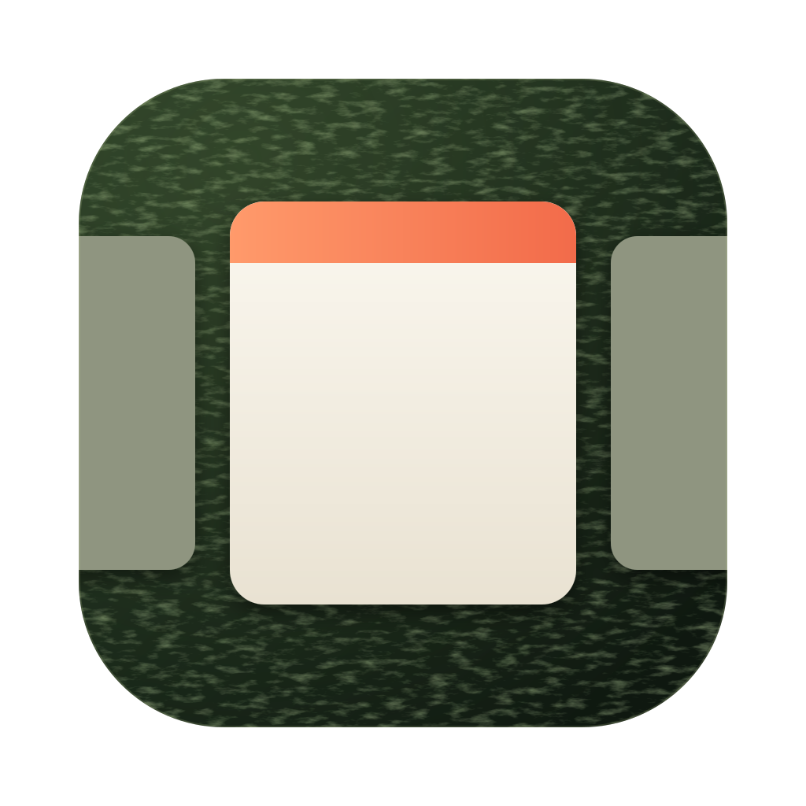

# nori

nori is a scrolling window manager for macOS, modeled on [niri](https://github.com/YaLTeR/niri). Windows stand side by side as columns on a horizontal strip, and the focused one sits in the middle of the screen.

It's a prototype. WindowServer moves the windows, not Accessibility. A dylib loaded into Dock calls private SkyLight functions every frame, so animations run on vsync and a slow app can't make them stutter. The price is that part of System Integrity Protection has to be off.

## Features

- Every window of the current Space is a column. The focused window sits in the center, the others line up left and right, `gap` apart.
- A new window opens right of the focused one and the strip scrolls to it. When a window closes, its neighbours close the gap.
- Clicking a window or switching to it with Cmd+Tab scrolls the strip to it.
- nori stretches a window to the full screen height when it joins the strip.
- Three fingers sideways drag the strip. Lift, and it settles on the nearest column. Past either end it stretches like rubber.
- Three fingers up or down move through Spaces the same way. The Spaces follow your fingers, and on lift the nearest one slides to the center, or the next one if you flicked. nori swallows macOS's own three-finger gestures.
- Drop a window you dragged with the mouse and it eases back into its column.
- Every Space has its own strip.
- Spaces switch vertically, on the same curve as windows. nori catches every "Switch to Desktop N" press, from the keyboard, from Opt+J/K or from `nori focus space`. Dock still switches the Space and the payload draws the slide. If nori quits or crashes, Dock goes back to its usual horizontal animation.
- An overview like niri's shows all Spaces of the display stacked and scaled down, with live windows. Four fingers drive it. It follows the swipe, stretches past fully open or closed, and on lift springs open or shut depending on how fast you threw it.

## Setup

nori needs macOS 14 or newer on Apple Silicon. I run it on macOS 27. Dock only loads a third-party dylib with part of SIP off, and that weakens the security of the whole machine. Do it on your own Mac, and see [Undo](#undo) for the way back. The steps match [yabai's](https://github.com/koekeishiya/yabai/wiki/Disabling-System-Integrity-Protection).

### 1. Turn off part of SIP, once, from Recovery

The app can't do this step for you. If SIP is still on, the app shows these steps and copies the command for you.

1. Shut the Mac down. Hold the power button until "Loading startup options" appears, then click Options → Continue and log in.
2. In the menu bar choose Utilities → Terminal and run
   ```sh
   csrutil enable --without fs --without debug --without nvram
   ```
   It warns about an unsupported configuration. That's expected.
3. Restart.

This turns off three protections. Without Debugging Restrictions the loader may call `task_for_pid` on Dock. Without NVRAM Protections the app can set the boot argument below. Filesystem Protections go too, as for yabai. The rest of SIP stays on.

### 2. Build and open the app

```sh
make app
open build/Nori.app     # or copy it to /Applications first
```

On launch the app checks the rest and fixes what it can. It asks for your password when it needs root.

1. **Boot argument.** Dock is an arm64e process and loads a third-party arm64e dylib only with `-arm64e_preview_abi` in `boot-args`. If the argument is missing, the app adds it and asks you to restart the Mac.
2. **Accessibility.** The event tap and window resizing need it. macOS shows its own prompt. Allow nori in System Settings → Privacy & Security → Accessibility and the app carries on by itself. The app has an ad hoc signature, so macOS may ask again after a rebuild. Remove the old nori entry and allow the new one.
3. **Payload.** If Dock doesn't have it, which happens on first launch and after a reboot or a Dock restart, the app restarts Dock and loads it.

After that nori lives in the menu bar.

| Menu item | What it does |
|---|---|
| Open Config | opens `~/.config/nori/config.toml` in your text editor, creating it if needed |
| Reload Config, ⌘R | reads the config again and lays the windows out with it |
| Restart Dock and Reload Payload | use it after a rebuild, so Dock runs the new payload |
| Quit nori, ⌘Q | puts Spaces back and quits. The payload stays in Dock and does nothing |

### 3. macOS settings

- **Desktop shortcuts.** Turn on "Switch to Desktop 1…N" in System Settings → Keyboard → Keyboard Shortcuts → Mission Control. Opt+J/K, the overview and `nori focus space` press them to switch Spaces.
- **Trackpad.** In System Settings → Trackpad → More Gestures, set "Swipe between full-screen applications" to four fingers or turn it off. Otherwise macOS flips Spaces along with the strip.
- **yabai.** If you have it, stop it while nori runs with `yabai --stop-service`, or at least run `yabai -m config layout float`.

### Check by hand

```sh
csrutil status     # "unknown (Custom Configuration)", Filesystem Protections,
                   # Debugging Restrictions and NVRAM Protections disabled
nvram boot-args    # boot-args	-arm64e_preview_abi
/usr/bin/log show --last 5m --predicate 'process == "Dock" AND eventMessage CONTAINS "nori"' --style compact   # payload log
```

### Running from a terminal

For development, run the binary without the bundle. It shows the same menu bar item and runs the same checks.

```sh
make        # builds everything into build/
make run    # stops a running nori, restarts Dock, loads the payload with sudo, runs nori in this terminal
```

Ctrl+C stops it. If you only changed the daemon, Dock needs no restart. Press Ctrl+C and run `build/nori` again.

### Releases

CI (`.github/workflows/build.yml`) builds an ad-hoc signed app on every push. When a push to main carries a version in `app/Info.plist` (`make version`) that has no release yet, CI signs the app with Developer ID, notarizes it, tags `v<version>` and attaches `Nori.zip` to a GitHub release. So a release is a version bump: `/make-new-release [patch|minor|major|X.Y.Z]` in Claude Code does it. CI needs these repository secrets:

| Secret | Value |
|---|---|
| `MACOS_CERTIFICATE` | the Developer ID Application certificate with its private key, exported as .p12 and base64-encoded |
| `MACOS_CERTIFICATE_PASSWORD` | the .p12 password |
| `NOTARY_KEY` | contents of an App Store Connect API key (.p8) with the Developer role |
| `NOTARY_KEY_ID`, `NOTARY_ISSUER_ID` | that key's ID and its issuer ID |

Locally: `make app SIGN="Developer ID Application"`.

A released app checks GitHub for a newer release at launch and every 6 hours, and offers it at the top of its menu. The update replaces the app, relaunches it and reloads the payload into Dock (password). An ad hoc build from `make app` never updates.

### Undo

1. In a normal Terminal, while NVRAM Protections are still off, run `sudo nvram -d boot-args`.
2. Boot into Recovery as in step 1, run `csrutil enable` and restart.

A repair at Apple or an authorized service provider may turn SIP back on too. Then repeat step 1.

## Keys

| Keys | Action |
|---|---|
| Ctrl+Opt+← / → | column to the left / right |
| Opt+H / Opt+L | column to the left / right |
| Opt+J / Opt+K | Space below / above, through the system "Switch to Desktop N" shortcuts. In the overview the neighbour slides to the center and becomes current, and the overview stays open |
| Opt+= / Opt+- | focused window wider / narrower by `resize-step`, animated |
| Opt+Shift+H / Opt+Shift+L | move the focused window one column left / right. Config names `move-left`, `move-right` |
| Opt+Shift+1…9 | send the focused window to Desktop N. Focus stays on this Space. Config names `move-to-space-N` |
| Opt + left drag | move the window under the pointer. It trades places with a neighbour once it passes the neighbour's center |
| Opt + right drag | resize the window under the pointer. It takes focus, and both edges follow the pointer |
| Opt+1…5 | Space 1…5. These are the system "Switch to Desktop N" shortcuts, and nori animates the switch itself |
| Opt+O | overview. Click a Space to pick it and the window under the pointer. Drag a window onto another Space to move it there. Esc or Opt+O closes it. Config name `overview` |
| in the overview: H/L or ←/→, J/K or ↓/↑, Return | move through the centered Space's columns, bring the Space below or above to the center, pick it |
| 4 fingers up / down | the overview follows the swipe and settles open or closed on lift. This replaces Mission Control on four fingers |

## Config

nori reads `~/.config/nori/config.toml`, a [TOML](https://toml.io) file, at start and on "Reload Config". If it meets a key it doesn't know or a value of the wrong kind, it prints a warning to stderr, skips that line and applies the rest.

```toml
gap = 16                  # between windows, in points
padding-top = 40          # from the menu bar
padding-bottom = 0        # from the Dock or the bottom of the screen
padding-left = 24
padding-right = 24
resize-step = 10          # width step, % of screen width, default 10
launch-at-login = true    # start Nori.app at login, default false

[bindings]
overview = "option+o"
grow-width = "option+="
shrink-width = "option+-"
move-left = "option+shift+h"
move-right = "option+shift+l"
move-to-space-1 = "option+shift+1"   # … up to move-to-space-9

[[rule]]
app = "Telegram"
space = 3
```

Missing numbers are 0, except `resize-step`. A missing binding keeps the default shown above. A binding is modifiers and one key joined by `+`. Modifiers are `option` or `alt`, `ctrl`, `cmd` and `shift`. The key is a letter, a digit, `-` or `=`, and nori reads it as a physical key on the US layout, so the binding stays put when you switch layouts.

`launch-at-login` adds Nori.app to System Settings → General → Login Items, or removes it, at launch and on "Reload Config". It only works for the app, not for `build/nori` in a terminal. The login item remembers where the bundle is, so move the app to /Applications first.

The TOML reader is nori's own and only knows what this file needs. That's comments, plain keys, `"strings"`, `'literal strings'`, numbers, `true`, `false`, `[tables]` and `[[arrays of tables]]`. It skips lines with dotted or quoted keys, arrays, inline tables, multi-line strings or dates, and says so.

### App rules

Each app gets one `[[rule]]` table. `app` is the app's name or bundle id, in any case. The first matching rule wins, and one rule can do several things.

```toml
[[rule]]
app = "Telegram"
space = 3              # new Telegram windows go to Desktop 3

[[rule]]
app = "com.apple.finder"
floating = true        # Finder windows stay out of the strip, wherever you put them

[[rule]]
app = "Raycast"
ignore = true          # nori doesn't move or list Raycast's windows
```

- `space = N` moves a window once, the first time nori sees it. That includes windows already open when nori starts. Move it back by hand and it stays. Focus stays on the current Space, unless the strip there is empty.
- `floating = true` keeps the app's windows out of the strip. nori doesn't move or resize them, and `nori query windows` lists them with `"isFloating": true`.
- `ignore = true` hides the app from nori completely, `nori query` too.
- "Reload Config" applies changed `floating` and `ignore` rules to open windows at once. A new `space` rule only affects windows nori hasn't seen yet.

## CLI

`nori` with arguments is the CLI. It asks the running nori about Spaces and windows, or tells it what to do. Queries answer in JSON, so `jq` works well with it. Actions print nothing when they work. On an error, or if nori isn't running, it prints to stderr and exits with 1.

Link the binary from the app somewhere on your PATH.

```sh
ln -s /Applications/Nori.app/Contents/MacOS/nori /opt/homebrew/bin/nori
```

```sh
nori query spaces [--current]           # number, windows, apps with their windows, column order
nori query windows [--space N] [--current] [--app NAME] [--id WID] [--focused]
nori focus left|right                   # column to the left / right
nori focus column N                     # column N on the current Space, counting from 1
nori focus space N                      # Desktop N, through "Switch to Desktop N"
nori focus window WID                   # a window by id, switching Spaces if needed
nori help

nori query windows --space 2 | jq -r '.[].app'
nori focus window "$(nori query windows --app Telegram | jq '.[0].id')"
```

A window has `id`, `pid`, `app`, `bundleId`, `title`, `space`, `spaceId`, `column`, `isFocused`, `isOnScreen`, `isFloating` and `frame`. `space` is the Desktop number. `column` counts from 1 and is missing for windows outside the strip. `--app` matches the app name or bundle id in any case. Desktops count from 1 across all displays, like the system shortcuts. Fullscreen Spaces have no number, and their `type` is `fullscreen`.

nori sees the titles of windows on other Spaces only with Screen Recording permission. When you run it from a terminal, the terminal needs that permission. Titles on the current Space come from Accessibility.

`nori` without arguments starts nori itself. A second copy refuses to start while one is running.

## Limitations

- One window per column.
- nori learns about new windows and focus changes from Accessibility and NSWorkspace notifications. If a window closes and focus doesn't move, nori notices on its next poll, up to a second later.
- Main display only.
- nori doesn't restore the original window sizes when it quits.

## License

MIT, see [LICENSE](LICENSE). `loader/loader.m` comes from [yabai](https://github.com/koekeishiya/yabai) and keeps its MIT license, see [loader/LICENSE](loader/LICENSE).
